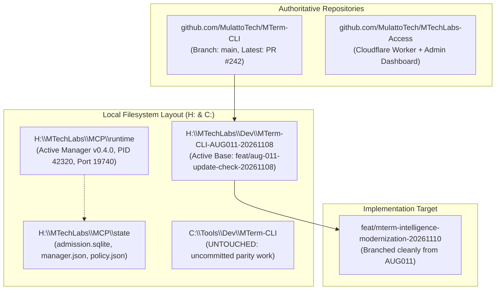
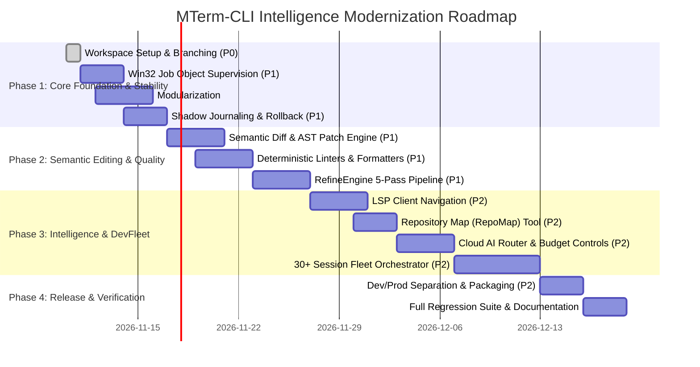

# MTerm-CLI — Complete Intelligence & Engineering Modernization Plan

> [!IMPORTANT]
> **Scope Directive:** Locally hosted AI inference (Ollama, llama.cpp, ROCm, AMD 7900 XTX local models) is **explicitly excluded** from implementation per user directive. All cloud AI providers (Gemini, Claude, OpenAI), model routing, reasoning workflows, deterministic code-quality tools, and architectural hooks for future local engines remain **fully in scope**.

---

## 1. Goal Description

Transform **MTerm-CLI** from a low-level, defensive MCP workstation tool server into an intelligent, highly reliable, and extensible AI software engineering and multi-agent orchestration platform.

This modernization plan addresses all 12 core engineering workstreams identified in the comprehensive audit, establishing:
1. **Semantic, AST-Aware Code Modification** (replacing fragile regex replacements with syntax-verified diffs).
2. **Automated Multi-Pass Quality Pipelines** (integrating Prettier, ESLint, Ruff, PSScriptAnalyzer, type checking, and test verification).
3. **Native Win32 Job Object Process Supervision** (eliminating `taskkill.exe` subprocess latency and console window flashing).
4. **Domain-Driven Codebase Modularization** (breaking down monolithic 500–1,000+ line files into decoupled, maintainable services).
5. **Language Server Protocol (LSP) Navigation** (exposing definition, reference, and compiler diagnostics to AI models).
6. **Token-Efficient Repository Intelligence** (ctags/AST repository maps with git-tree caching).
7. **Rigorous Dev / Prod Isolation** (`MTerm-CLI` vs. `MTerm-CLI-DEV`).
8. **30+ Session Multi-Agent Fleet Orchestration** (SQLite-backed persistent task queues, admission limits, checkpoints, and backpressure).
9. **Transactional Rollback and Shadow Journaling** (safe multi-file operation reversibility).
10. **Extensible Cloud AI Integration & Routing** (Gemini, Claude, OpenAI routing with token budgets and structured self-review).
11. **Security & Boundary Enforcement** (preserving read-only defaults, path jails, sensitive file masks, and Cloudflare Access security).
12. **Developer Experience & Tool Usability** (structured outputs, actionable error remediation, and updated diagnostic doctor).

---

## 2. User Review Required

> [!WARNING]
> **Preservation of `C:\Tools\Dev\MTerm-CLI`:**
> The older development checkout at `C:\Tools\Dev\MTerm-CLI` contains uncommitted work on branch `feat/codex-parity-foundation-20261005` (`src/cli.ts`, `src/files.ts`, `src/mcp.ts`, `src/processes.ts`, `src/compat-config.ts`). This plan designates `H:\MTechLabs\Dev\MTerm-CLI-AUG011-20261108` as the clean base for branching `feat/mterm-intelligence-modernization-20261110`. The legacy directory will remain strictly read-only and untouched.

> [!IMPORTANT]
> **Node.js Runtime & Native Windows Bindings:**
> The native Win32 Job Object supervision (Workstream 3) will be implemented as a zero-dependency C++ Node N-API addon with a graceful PowerShell Win32 API fallback, ensuring 100% portability without requiring user-side compilation toolchains if prebuilts are absent.

---

## 3. Verified Baseline & Architecture Topology

---

## 4. Workstream Implementation Plans

---

### Workstream 1: Semantic Code Editing & Verified Patch Application

#### Objectives & Existing Limitations
- **Current Behavior:** `FileService.write` requires whole-file rewrites matching the exact SHA-256 (`expectedVersion`), causing cascade conflict failures during multi-turn LLM generation. `editBlock` performs naive substring replacement (`before.text.split(search).join(replacement)`) with no AST checks, risking syntax corruption.
- **Intended Behavior:** Provide `mterm_apply_patch` supporting unified diffs with exact hunk anchoring, fuzzy fallback, syntax validation before disk write, and line-ending preservation.

#### Architecture & Proposed Changes
- Preflight File Verification (path jail, permissions).
- Semantic Hunk Matcher (exact -> whitespace-tolerant).
- In-memory patch application and AST syntax validation (TypeScript/JavaScript, Python, JSON, PowerShell).
- Atomic File Commit with journaled staging.

#### Files Affected
- `[NEW]` `src/editing/semantic-editor.ts` — Diff parsing, hunk application, and line-ending preservation.
- `[NEW]` `src/editing/syntax-validator.ts` — AST syntax checking for TypeScript/JavaScript, Python, JSON, and PowerShell.
- `[MODIFY]` `src/mcp.ts` — Register `mterm_apply_patch` and `mterm_validate_syntax` tools.
- `[MODIFY]` `src/desktop-commander-files.ts` — Upgrade `editBlock` to use `semantic-editor.ts`.

#### Verification & Acceptance Criteria
- Unit tests: Unified diff with 1–10 hunks applied successfully to CRLF and LF files.
- Rejection tests: Malformed JavaScript (missing braces, invalid syntax) rejected with specific line/column diagnostics without writing to disk.

---

### Workstream 2: Intelligent Code-Quality Engine (`RefineEngine`)

#### Objectives & Existing Limitations
- **Current Behavior:** Zero integrated linters, formatters, or typecheckers. The model must blindly edit files and hope formatting/types match project style.
- **Intended Behavior:** Provide deterministic quality gate tools and an automated 5-pass refinement pipeline (`Understand -> Plan -> Mutate -> Lint/TypeCheck -> Test -> Refine`).

#### Tool Registrations
- `mterm_format_file`: Auto-formats via Prettier (JS/TS/JSON/MD), Ruff/Black (Python), or PSScriptAnalyzer (PowerShell) using project configuration files.
- `mterm_lint_check`: Runs language-specific linter and returns structured diagnostics array: `[{ file, line, column, severity, ruleId, message, fixable }]`.
- `mterm_typecheck`: Runs `tsc --noEmit` or Pyright with structured error output.
- `mterm_run_tests`: Targeted test runner executing only tests related to modified files.

#### Files Affected
- `[NEW]` `src/quality/formatter.ts` — Prettier / Ruff / PSScriptAnalyzer wrapper.
- `[NEW]` `src/quality/linter.ts` — ESLint / Ruff / PSScriptAnalyzer execution and diagnostic parser.
- `[NEW]` `src/quality/typecheck.ts` — TypeScript compiler diagnostic extractor.
- `[NEW]` `src/quality/refine-pipeline.ts` — Configurable multi-pass loop orchestrator.

#### Verification & Acceptance Criteria
- Code formatting automatically applies detected project config (`.prettierrc`, `ruff.toml`).
- Lint diagnostics returned in structured JSON with zero terminal scraping.

---

### Workstream 3: Native Win32 Job Object Process Supervision

#### Objectives & Existing Limitations
- **Current Behavior:** `ProcessService.stop` spawns `taskkill.exe /F /T /PID`, causing subprocess overhead, intermittent console window flashes, and potential orphan processes if the parent terminates before `taskkill` attaches.
- **Intended Behavior:** Kernel-level process tree containment using Win32 Job Objects. Processes spawned by `mterm_start_process` are immediately assigned to a dedicated Job Object with `JOB_OBJECT_LIMIT_KILL_ON_JOB_CLOSE`.

#### Files Affected
- `[NEW]` `src/native/win32-job.ts` — Win32 Job Object wrapper via Node N-API / FFI with fallback.
- `[MODIFY]` `src/processes.ts` — Integrate `Win32JobObject` into `ProcessService`, replacing `taskkill.exe` subprocess calls.

#### Verification & Acceptance Criteria
- Spawning a child that spawns 5 background child processes, then killing the parent session leaves **zero** surviving background processes.
- Process termination executes in < 5ms with zero console window flashes.

---

### Workstream 4: Codebase Modularization & Refactoring

#### Objectives & Existing Limitations
- **Current Behavior:** Monolithic implementations in `src/files.ts` (540 lines), `src/processes.ts` (560 lines), `src/tool-packs.ts` (1,041 lines), and `src/desktop-commander-files.ts` (461 lines).
- **Intended Behavior:** Decompose into clean, decoupled domain services under 250 lines each without breaking existing public APIs or test suites.

#### Architecture & Proposed Changes
- Split `files.ts` into `src/files/atomic-writer.ts`, `src/files/retry-strategy.ts`, `src/files/file-service.ts`.
- Split `tool-packs.ts` into `src/packs/pack-manifest.ts`, `src/packs/pack-verifier.ts`, `src/packs/pack-catalog.ts`.

#### Verification & Acceptance Criteria
- All 40+ existing test suites in `tests/*.test.mjs` pass with zero regressions.

---

### Workstream 5: Language Server Protocol (LSP) Client Integration

#### Objectives & Existing Limitations
- **Current Behavior:** AI models have no way to jump to definitions, find all references, or query workspace symbols without reading large files or doing grep searches.
- **Intended Behavior:** Expose standard LSP navigation tools over MCP.

#### Tool Registrations
- `mterm_lsp_definition`: Returns target file path, line, and column for a symbol at a given position.
- `mterm_lsp_references`: Returns all occurrences across the repository.
- `mterm_lsp_symbols`: Returns hierarchical symbols in a file or workspace.

#### Files Affected
- `[NEW]` `src/lsp/client.ts` — Base JSON-RPC LSP client.
- `[NEW]` `src/lsp/manager.ts` — Language server lifecycle and discovery.
- `[MODIFY]` `src/mcp.ts` — Expose LSP tools when language servers are detected.

---

### Workstream 6: Repository Intelligence & Context Optimization

#### Objectives & Existing Limitations
- **Current Behavior:** Models must scan directories recursively or rely on grep, wasting thousands of context tokens on boilerplate file lists.
- **Intended Behavior:** Provide `mterm_repo_map`: a dense, token-efficient summary of the codebase structure (classes, methods, exported functions, docstrings) indexed and cached by git-tree SHA.

#### Files Affected
- `[NEW]` `src/intelligence/repomap.ts` — Repository map generator and cache.
- `[MODIFY]` `src/mcp.ts` — Expose `mterm_repo_map` tool.

---

### Workstream 7: Development vs. Production Separation

#### Objectives & Existing Limitations
- **Current Behavior:** Multiple worktrees and manual script copies risk accidental mixing of experimental features with stable tools.
- **Intended Behavior:** Clearly differentiated dual-environment topology:
  - **MTerm-CLI (Production):** Pinned, stable release (`0.0.1-preview.1` -> `0.1.0`), linked globally, bound to `%USERPROFILE%\.mterm\`.
  - **MTerm-CLI-DEV (Experimental):** Isolated development builds (`0.1.0-dev.*`), bound to `%USERPROFILE%\.mterm-dev\`, using distinct test ports (e.g. 19741).

#### Files Affected
- `[MODIFY]` `Start-MTerm-CLI.ps1` — Add `--dev` flag supporting isolated dev profiles.
- `[NEW]` `scripts/dev-environment-setup.mjs` — Setup and verify isolated dev environment.

---

### Workstream 8: Multi-Session Fleet Orchestration (30+ Sessions)

#### Objectives & Existing Limitations
- **Current Behavior:** Coordinating 30+ simultaneous ChatGPT Web Pro sessions and external coding workers requires robust orchestration. Existing stdio host is 1-to-1 client; runtime manager has admission queue for tool requests, but no agent task lifecycle.
- **Intended Behavior:** Persistent task supervision capable of coordinating 30+ concurrent logical agent sessions with token buckets, priority queues, and checkpoint recovery.

#### Files Affected
- `[NEW]` `src/orchestration/fleet-manager.ts` — Task queue and session supervisor.
- `[NEW]` `src/orchestration/fleet-db.ts` — SQLite task and checkpoint persistence.
- `[MODIFY]` `H:\MTechLabs\MCP\runtime\gateway.mjs` — Integrate fleet admission controls.

---

### Workstream 9: Rollback, Snapshots, and Shadow Journaling

#### Objectives & Existing Limitations
- **Current Behavior:** Erroneous multi-file edits require manual git reverts.
- **Intended Behavior:** Automatic snapshotting before destructive edits, with transactional rollback: if file 3 of 5 fails, files 1 and 2 are automatically rolled back.

#### Files Affected
- `[NEW]` `src/journaling/shadow-journal.ts` — Pre-mutation file backup and journal tracking.
- `[MODIFY]` `src/files.ts` — Hook shadow journal before file mutations.
- `[MODIFY]` `src/mcp.ts` — Register `mterm_rollback` tool.

---

### Workstream 10: Cloud AI Integration & Model Routing (Optional Reasoning Layer)

#### Objectives & Existing Limitations
- **Current Behavior:** MTerm-CLI has no intelligence coordination layer.
- **Scope Restriction:** Exclude all local LLM hosting. In scope: Cloud model providers (Gemini, Claude, OpenAI) with intelligent routing and cost controls.
- **Intended Behavior:** Provide an extensible model provider adapter and routing engine that assigns tasks based on complexity.

#### Files Affected
- `[NEW]` `src/ai/model-provider.ts` — Extensible provider interface.
- `[NEW]` `src/ai/providers/gemini.ts` — Google Gemini adapter.
- `[NEW]` `src/ai/providers/claude.ts` — Anthropic Claude adapter.
- `[NEW]` `src/ai/providers/openai.ts` — OpenAI adapter.
- `[NEW]` `src/ai/router.ts` — Task complexity classifier and cost guard.

---

### Workstream 11: Security & Boundary Hardening

#### Objectives & Existing Limitations
- **Current Behavior:** Strong existing security defaults (read-only by default, path jail). Must be preserved while adding new tools.
- **Intended Behavior:** Ensure all newly introduced tools (patches, formatters, linters, LSP) strictly adhere to `--root` path boundaries and least-privilege principles.

#### Files Affected
- `[MODIFY]` `src/policy.ts` — Centralize boundary checks for new quality and LSP tools.

---

### Workstream 12: Developer Experience & Tool Usability

#### Objectives & Existing Limitations
- **Current Behavior:** Error messages frequently return raw Node.js error codes without actionable guidance. `mterm-cli doctor` lacks modern checks.
- **Intended Behavior:** Actionable error reporting, rich `--json` CLI formatting, and comprehensive diagnostics.

#### Files Affected
- `[MODIFY]` `src/cli.ts` — Enhance `doctor` command and CLI output formatting.
- `[MODIFY]` `src/errors.ts` — Enrich error codes with human remediation suggestions.

---

## 5. Implementation Roadmap & Dependency Sequence

---

## 6. Durable Implementation Tracking Status

A durable progress ledger is saved at `docs/plans/MODERNIZATION_STATUS.json` with verifiable states: `Not started`, `In progress`, `Blocked`, `Implemented`, `Verified`, `Merged`, `Deployed`, `Excluded by user`.

| Requirement ID | Feature Name | Workstream | State | Target Milestone |
| :--- | :--- | :---: | :---: | :--- |
| **MOD-001** | Win32 Job Object Process Supervision | 3 | **Not started** | Phase 1 |
| **MOD-002** | Decompose `files.ts` into Atomic Services | 4 | **Not started** | Phase 1 |
| **MOD-003** | Shadow Journaling & Pre-Mutation Snapshots | 9 | **Not started** | Phase 1 |
| **MOD-004** | Transactional `mterm_rollback` Tool | 9 | **Not started** | Phase 1 |
| **MOD-005** | Semantic Unified Diff Engine (`mterm_apply_patch`) | 1 | **Not started** | Phase 2 |
| **MOD-006** | Pre-Save Syntactic AST Validator | 1 | **Not started** | Phase 2 |
| **MOD-007** | Deterministic Multi-Linter Tool (`mterm_lint_check`) | 2 | **Not started** | Phase 2 |
| **MOD-008** | Automated Code Formatter Tool (`mterm_format_file`) | 2 | **Not started** | Phase 2 |
| **MOD-009** | 5-Pass Self-Healing Refine Pipeline (`RefineEngine`) | 2 | **Not started** | Phase 2 |
| **MOD-010** | Language Server Protocol Client (`mterm_lsp_*`) | 5 | **Not started** | Phase 3 |
| **MOD-011** | Dense Repository Map Generator (`mterm_repo_map`) | 6 | **Not started** | Phase 3 |
| **MOD-012** | Cloud AI Provider Adapters & Model Router | 10 | **Not started** | Phase 3 |
| **MOD-013** | 30+ Agent Fleet Supervisor & SQLite Task Queue | 8 | **Not started** | Phase 3 |
| **MOD-014** | Dual Dev/Prod Packaging (`mterm-cli-dev`) | 7 | **Not started** | Phase 4 |
| **MOD-015** | Enhanced Diagnostics (`mterm-cli doctor --json`) | 12 | **Not started** | Phase 4 |
| **MOD-EX01**| Locally Hosted AI Inference (Ollama/llama.cpp/ROCm) | N/A | **Excluded by user**| N/A |

---

## 7. First Three Execution Tasks for `/goal`

When execution is authorized, the first milestone will execute these immediate, independently testable tasks:

1. **Task 1: Establish Feature Branch & Baseline Gate**
   - Create branch `feat/mterm-intelligence-modernization-20261110` off `H:\MTechLabs\Dev\MTerm-CLI-AUG011-20261108`.
   - Verify that all baseline tests (`npm test`) pass cleanly before introducing code changes.
2. **Task 2: Implement Win32 Job Object Supervision (`src/native/win32-job.ts`)**
   - Implement the kernel Job Object manager with `JOB_OBJECT_LIMIT_KILL_ON_JOB_CLOSE`.
   - Integrate with `ProcessService` to replace `taskkill.exe` subprocess execution.
   - Run unit test verifying zero surviving child processes and zero window flashes.
3. **Task 3: Refactor `files.ts` & Add Shadow Journaling (`src/files/` & `src/journaling/`)**
   - Extract `AtomicFileWriter` and `WindowsRetryStrategy`.
   - Implement pre-mutation shadow snapshotting in `.mterm-journal/`.
   - Expose `mterm_rollback` MCP tool and verify with transactional multi-file test.
